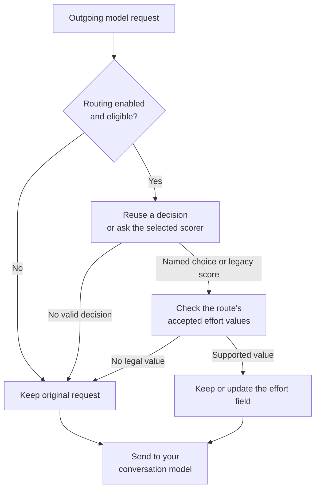
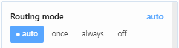
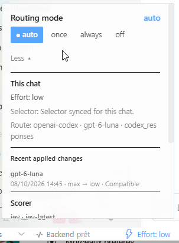
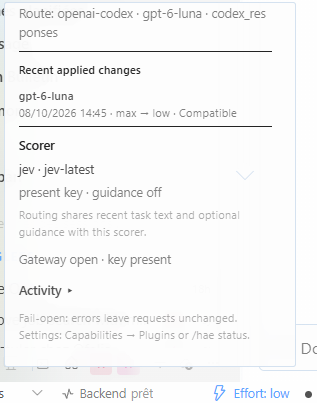

# Hermes Adaptive Effort

[](https://github.com/atostivint/hermes-adaptive-effort/actions/workflows/ci.yml) [](https://github.com/atostivint/hermes-adaptive-effort/actions/workflows/security.yml)

A Hermes plugin that asks a separate scorer to judge a task, then adjusts the reasoning effort of the outgoing model request.

Your conversation model still answers the task. You choose the scorer: Jev (the default), OpenAI Decisions, an OpenRouter decision model (Decisions API), Cloudflare Clef / Clef Flash / Clef Omni, Nace Drex (`drex-v2.0`, key `NACE_API_KEY`), or a custom System One endpoint.

> **Preview:** v0.3.0 is a pre-release. Live effort acceptance is only partially validated; see the [release notes](docs/releases/v0.3.0.md#validation-status--read-before-relying-on-it).

The plugin starts **off**. When you enable routing, it changes a supported effort field and can add a missing field on exact registered routes. If classification fails, the original request continues unchanged. A transient scorer HTTP error (408, 429, 500, 502, 503, 504) is retried once, only inside the `timeout_s` deadline; timeouts, other errors and received answers are never retried. After three consecutive scorer failures (timeout, transport, HTTP or malformed answer) the selected scorer is paused for 60 seconds and requests skip it with `scorer_paused`; see `scorer_pause_failures` and `scorer_pause_s` in [Configuration](docs/CONFIGURATION.md). The saved latency is unmeasured. The scorer deadline defaults to the selected provider's value (`timeout_s: 0`; Jev 2 s, custom 10 s, others 3 s), also unmeasured on this plugin's traffic; see [Configuration](docs/CONFIGURATION.md). `/hae status` shows the p95 of the scorer's observed latency (a bucket bound, counts only, this process) once calls have been made: use it to tune `timeout_s`. It also shows how often the scorer chose each effort label on the current route (for example `Effort labels (kimi-k3): low 12 · medium 30 · high 4`), and notes when one label is at least 90% of at least 30 answers, which can mean the scorer collapsed to a fixed effort. Counts are per process and informational only.

## Quick start

### 1. Install and enable the plugin

```bash
hermes plugins install 'atostivint/hermes-adaptive-effort' --enable
```

The repository root is the plugin payload; install without a subdirectory suffix. Hermes manages installation and updates. The payload is not a Python package.

An older CLI may require installation without `--enable`, followed by:

```bash
hermes plugins enable hermes-adaptive-effort
```

### 2. Choose a scorer and provide its key

Any one scorer is enough; Jev is only the default. Pick one:

| Scorer | `scorer_provider` | Key variable | Also required |
| --- | --- | --- | --- |
| Jev (TypeSafe) | `jev` (default) | `TYPESAFE_API_KEY` | Nothing |
| OpenAI Decisions | `openai_decision` | `OPENAI_API_KEY` | Nothing (`gpt-6-luna` by default) |
| OpenRouter Decisions | `openrouter` | `OPENROUTER_API_KEY` | A decision model in `scorer_model` |
| Cloudflare Clef | `cloudflare` | `CLOUDFLARE_AUTH_TOKEN` | Your 32-hex `cloudflare_account_id` |
| Nace Drex | `nace` | `NACE_API_KEY` | Nothing (`drex-v2.0` by default) |
| Custom / local System One server | `custom` | none, or `CUSTOM_SCORER_API_KEY` | `custom_endpoint` and `scorer_model` |

Put the key in the `.env` file of the Hermes profile that serves your requests (`~/.hermes/.env` on Linux/macOS, `%LOCALAPPDATA%\hermes\.env` on Windows for the default profile), for example:

```dotenv
OPENAI_API_KEY=YOUR_KEY
```

Then select the scorer in Desktop (**Capabilities → Plugins → Hermes Adaptive Effort**) or in the `plugins.entries.hermes-adaptive-effort.settings` block of `config.yaml`. Keep keys out of `config.yaml`.

<details>
<summary><b>Jev</b> — default, no extra setting</summary>

Get `TYPESAFE_API_KEY` from your TypeSafe account. No setting is needed; to be explicit:

```yaml
settings:
  scorer_provider: jev
```

</details>

<details>
<summary><b>OpenAI Decisions</b></summary>

Use an `OPENAI_API_KEY` from your OpenAI API account. The plugin calls the fixed Decisions endpoint with `gpt-6-luna` unless `scorer_model` names another model.

```yaml
settings:
  scorer_provider: openai_decision
```

</details>

<details>
<summary><b>OpenRouter Decisions</b></summary>

Create an [OpenRouter key](https://openrouter.ai/keys) as `OPENROUTER_API_KEY` and name a **decision model** (a chat model slug does not work):

```yaml
settings:
  scorer_provider: openrouter
  scorer_model: "typesafe/jev-1.13"   # or another OpenRouter decision model, e.g. cloudflare/clef-omni
```

</details>

<details>
<summary><b>Cloudflare Clef, Clef Flash or Clef Omni</b></summary>

In **Cloudflare dashboard → Workers AI → Use REST API**, create a Workers AI token (`CLOUDFLARE_AUTH_TOKEN`) and copy your Account ID:

```yaml
settings:
  scorer_provider: cloudflare
  cloudflare_account_id: "YOUR_32_HEX_ACCOUNT_ID"
  cloudflare_model: clef   # clef, clef-flash or clef-omni
```

</details>

<details>
<summary><b>Nace Drex</b></summary>

Create a key in the [Nace console](https://console.nace.ai) as `NACE_API_KEY` (the legacy `DREX_API_KEY` is still read):

```yaml
settings:
  scorer_provider: nace
  nace_model: drex-v2.0
```

</details>

<details>
<summary><b>Custom or local System One server</b></summary>

Point the plugin at a server you run that speaks the System One format. No cloud account is needed:

```yaml
settings:
  scorer_provider: custom
  custom_endpoint: "http://127.0.0.1:8099/v1/systemone"
  scorer_model: "YOUR_SERVED_MODEL_NAME"
  custom_auth: none   # or bearer, with CUSTOM_SCORER_API_KEY in .env
```

</details>

A key exported only in a terminal (`export OPENAI_API_KEY=...`, or `$env:OPENAI_API_KEY = "..."` in PowerShell) reaches only a Hermes started from that terminal, not a running gateway or Desktop agent. The [configuration guide](docs/CONFIGURATION.md#configure-your-scorer) covers each scorer in detail: endpoints, defaults, data handling and failure behavior.

### 3. Restart the serving Hermes process

Restart your local agent, or restart the gateway:

```bash
hermes gateway restart
```

Desktop connections can use separate agent processes. Reconnect the connection that will serve your requests.

### 4. Check readiness and choose a mode

In Hermes chat:

```text
/hae status
/hae auto
```

Status checks readiness without classifying anything. Enabling a routing mode authorizes sharing bounded task text with the selected scorer. The chat command applies to future requests in the current process; save the mode in Desktop plugin settings if it should survive a restart.

## Choose when to evaluate effort

| Mode | Behavior |
| --- | --- |
| `off` (default) | No scoring or request changes |
| `auto` | Evaluate each new user turn on exact verified dynamic routes; otherwise retain one decision per model and route |
| `once` | Retain one decision per model and route for the conversation |
| `always` | Evaluate every new user turn on eligible routes |

`/hae status` and the Desktop details panel say whether the current route changes effort every turn and why, for example `Effort changes: every turn — dynamic (listed)`, `Effort changes: every turn — on trial (1/3)` or `Effort changes: once, then kept — not dynamic (observed cache loss)`. The existing `Cache:` line is unchanged.

**Trial of unlisted routes.** In `auto`, a cache-safe route that is not in the exact registry used to keep one decision forever. With `dynamic_trial` (default `true`) such a route, if it already carries an effort field, changes effort every turn *on trial* while the plugin reads the provider's cache counters from Hermes' `post_api_request` hook. Three effort changes that keep the cache make the route dynamic (`observed`); a clear cache drop right after a change, a rejected level (HTTP 400/422), or five responses with no cache counters pin it again. Verdicts are remembered in the profile's plugin-data SQLite file, never in config, and keep only token counts and effort values. Claude routes and cache-hostile API modes are never trialled. The thresholds are heuristics; the worst case is one cache miss, and the cost and cache effect are unmeasured. Set `dynamic_trial: false` to keep one decision per unlisted route.

Every active mode reuses its decision during a tool loop. A route includes the provider, exact model and API mode. Bounded decision memory can be evicted or cleared on reset/reload.

`/hae <mode> here` sets a mode for the current conversation only, and `/hae default here` clears it. A conversation override takes precedence over the default mode for that parent conversation; subagents keep `subagent_mode`.

Use `/hae help` for all commands. The [usage guide](docs/USAGE.md) explains mode selection, status, probing and troubleshooting.

## How a request passes through the plugin



For exact registered routes, the selected scorer chooses directly from that route's allowed levels. For example, Kimi K3 offers `low/high/max`, OpenAI's GPT-6.1 Sol route offers `low/medium/high/xhigh/max`, and native Claude Opus 5.5 offers those same five levels. Claude Opus 4.6 offers `low/medium/high/max`, without `xhigh`. One-level routes are fixed without a scorer call. Routes without an exact choice vocabulary keep the legacy finite `0..2` score mapped to `low`, `medium` or `high`; `/hae probe` also keeps that score contract. A route change re-clamps the stored named level using the compatibility rules and never promotes `xhigh` to the new route's `max` automatically.

When an already classified turn falls back to a request with no writable effort field, its request continues unchanged and status names that fallback route as `unsupported`. The turn's earlier decision remains available if a later request reaches an eligible route. The exact OpenCode Go `mimo-v2.6-flash` Chat Completions route is registered to inject top-level `reasoning_effort` (`low`, `medium`, or `high`) on a fallback without a field. Direct Go requests have accepted these values, but Xiaomi currently treats all non-`none` levels as enabled reasoning; no cost or reasoning-depth difference is established. See the [compatibility matrix](docs/MODEL_COMPATIBILITY.md).

The scorer receives the latest user text, or the parent-written goal for a registered subagent. Scoring and answering are separate calls with separate costs. The allowed levels are included in the scorer question; model identity and observed effort are shared only when `use_target_model_context` is enabled, and earlier conversation text only when `dialogue_context_messages` is above 0.

See [Design](docs/DESIGN.md) for the component diagram and [Contracts](docs/CONTRACTS.md) for the tool-loop sequence and failure rules.

## Desktop and terminal

The optional Desktop extension adds an Effort chip. It shortens effort names for display (`minimal` → `min`, `medium` → `med`; `default` means the request had no effort field, and `N/A` means no decision yet) and shows `previous → chosen`, for example `low → high`. A **Chip display** toggle in the popup switches the chip to the chosen effort only, for example `med`; the preference is kept in Desktop plugin storage, never in `config.yaml`. The popup itself stays compact: **More** reveals conversation and scorer details plus recent applied changes for that chat; **Activity** shows aggregate status. In a Hermes chat, `/hae` opens the same conversation's recent history, and `/hae status` summarizes its model, selected effort and cache behavior.



The popup keeps the four routing modes together. **More** adds this chat's effort, whether the native selector is synced, and the route:



Further down, the popup lists the latest applied change and the selected scorer, with its key and guidance state but never the key itself:



The plugin's settings page lists every scorer provider and its options. The screenshots are from a French-language Desktop.


See the [interface guide](docs/USAGE.md#desktop-and-terminal) for notifications, focused-chat status and the native effort selector.

The chip matches decisions to the chat's stored conversation ID; Desktop's temporary runtime ID is used only for session actions. Both live events and status polling follow this distinction.

## What to expect

How much effort routing saves depends on how many of your tasks are easy compared with the effort your model uses by default. A workload made of hard tasks saves little, because most requests keep a high level.

Published adaptive-effort systems report output-length reductions from about 13% to 76% depending on the benchmark. [Learning When to Think](https://arxiv.org/html/2608.20256) measured 76% on GSM8K, 41% on MATH-500 and about 13% on AIME, where the router sends nearly everything to the long mode; these reductions are against the untrained base model. [Ares](https://arxiv.org/html/2603.07915v1) reports from about 35% to 53% fewer reasoning tokens on agent benchmarks, against fixed high effort. These are other systems on other benchmarks, not comparisons with or without this plugin. This plugin has not been measured, and no saving is promised.

Too much effort can also cost quality, not only money: Ares found medium effort ahead of high on one benchmark (42.0% against 38.0% on TAU-Bench Airline). Treat that as a reason to compare, not as a guarantee.

More systematic evidence points the same way. [What Effort Level Should I Choose?](https://arxiv.org/abs/2610.34491) (Sun et al., 2026) measured eight models on four benchmarks, including agentic tasks, and found that higher effort can lose tasks a lower level solved; on tasks every level solves, the top level cost up to 42x the lowest; and higher effort changes an agent's strategy (more self-verification and retrieval) rather than only adding deliberation. Their deployable policy - start at the lowest level and retry at the highest only after an externally verified failure ("naive laddering") - matched or beat fixed top effort at lower median cost on most benchmarks. The lesson is to start low and raise on evidence, not to assume a higher level is safer. This plugin cannot perform that fresh retry: `tool_error_escalation` raises effort inside the same turn after a repeated tool error, so it is a weaker, bounded proxy. The paper does not measure this plugin.

If you want a cost-conscious posture today, keep `tool_error_escalation` on and use `classification_instructions` to prefer the lowest level that can plausibly solve the task. Leave `effort_ceiling` empty so escalation can still reach the top: a ceiling is a hard cap, not a ladder, and it also caps tool-error escalation.

## Data sharing and limits

- Enabling routing sends at most `prompt_chars` task characters (default 4,000), plus optional classifier guidance and the allowed level names for named-choice routes, to the selected scorer. Target model context is a separate opt-in setting.
- `dialogue_context_messages` (default `4`, maximum 6; `0` turns it off): when above 0, enabling routing also shares up to that many earlier user and assistant text messages (each at most 1,200 characters, oldest first, labelled as untrusted context) with the selected scorer so a follow-up such as "yes, go ahead" is judged with the task it refers to. System and developer messages, tool calls, tool results and non-text parts are never included, and subagent classification and `/hae probe` never carry it. With `0` the scorer request is unchanged.
- `continuation_downgrade_votes` (default `2`, maximum 5; `0` = off) works only together with dialogue context: it adds a second, separate yes/no request (same text and dialogue block, in parallel with the effort request) so that in `always`, and `auto` on exact dynamic routes, a lower effort choice on a continuation applies only after that many consecutive lower votes. It costs one more scorer request per turn; with either setting at `0` no second request is made.
- `effort_floor` / `effort_ceiling` (default empty = no bound; `off` or `none` also switch a bound off) are local: they clamp the scorer's answer after it is received and change nothing that is sent to the scorer.
- `tool_error_escalation` (default `true`) is local: it shares nothing and calls no scorer. Only the SHA-256 of a normalised tool error is compared in memory.
- `goal_continuation_escalation` (default `false`) is local: a `/goal`, `/subgoal`, failed-gate or kanban goal-loop continuation is recognised by its host-generated first line and raises effort one level above the previous attempt for that retry turn. It calls no scorer and stores no prompt text. It is off by default because the goal judge can fail open; see [raise effort after a failed goal check](docs/CONFIGURATION.md#raise-effort-after-a-failed-goal-check).
- `respect_manual_effort` (default `true`) is local too: when the effort of a conversation changes without the plugin having written it (a config or selector change you made), the plugin stands down for that conversation until you pick a mode for it again with `/hae <mode> here` or the Desktop mode popup (or the session resets). While stood down it makes no scorer call, rewrites nothing and shares nothing; `/hae status` says so. Detection is inference: a manual choice equal to a value the plugin last read or wrote cannot be seen. **This default changes behaviour for existing users**; set `false` for the previous behaviour.
- `dynamic_trial` (default `true`) is local too: it watches the provider's own cache counters (token counts only) and shares nothing with a scorer.
- `/hae probe <text>` explicitly scores the text you type, even while routing is off. It stores no decision and may incur charges.
- The plugin excludes prompts and guidance from status, logs and change events. Provider retention is separate; see [data sharing](docs/CONFIGURATION.md#data-sharing).
- Applied-change history stores only effort transitions, model names and bounded decision metadata in the active Hermes profile. It retains at most 64 changes per conversation and 64 conversations; a conversation reset clears its history. It never stores task or prompt text.
- Reasoning support alone does not prove that a route accepts an effort field. The [compatibility matrix](docs/MODEL_COMPATIBILITY.md) distinguishes registered controls, documentation and live observations.
- Explicitly disabled or malformed reasoning controls stay untouched. Subagents have an independent mode that also defaults to `off`.
- Cost savings, cache benefits and answer-quality improvements remain unmeasured. Classification adds latency and may add cost.

## Update or disable

```bash
hermes plugins update hermes-adaptive-effort
hermes plugins disable hermes-adaptive-effort
```

Restart the serving agent after updates or enable/disable changes. `/hae off` stops routing for future requests in the current process.

For migration from `jev-auto-effort`, follow [migration instructions](docs/USAGE.md#migrate-from-jev-auto-effort).

## Documentation

| You want to… | Start here |
| --- | --- |
| Configure a scorer, keys or advanced settings | [Configuration](docs/CONFIGURATION.md) |
| Choose a mode or diagnose a missing change | [Usage](docs/USAGE.md) |
| Understand the implementation and trade-offs | [Design](docs/DESIGN.md) · [Version française expliquée](docs/DESIGN.fr.md) |
| Check exact behavior and API contracts | [Contracts](docs/CONTRACTS.md) |
| Check a model/provider route | [Compatibility](docs/MODEL_COMPATIBILITY.md) |
| Contribute and reproduce checks | [Development](docs/DEVELOPMENT.md) |
| Find dated reports and operator notes | [Documentation index](docs/README.md) |

## License

[MIT](LICENSE) © 2026 Alexandre Tostivint and contributors.
