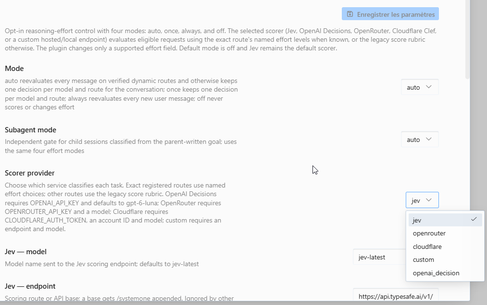

# Configuration

[Quick start](../README.md#quick-start) · [Usage and troubleshooting](USAGE.md) · [Runtime contracts](CONTRACTS.md)

The scorer classifies the task; your conversation model answers it. Selecting a scorer while `mode: off` sends no task text. Enabling `auto`, `once` or `always` authorizes sharing the bounded task, configured guidance and—on exact named-choice routes—the allowed effort names with that scorer.

## Save settings

In Desktop, open **Capabilities → Plugins → Hermes Adaptive Effort**. The settings form groups fields by their labels: mode, scorer, classification, advanced limits and display.



You can also merge settings into your Hermes home's `config.yaml`:

```yaml
plugins:
  enabled:
    - hermes-adaptive-effort
  entries:
    hermes-adaptive-effort:
      settings:
        mode: auto
        scorer_provider: jev
        jev_model: jev-latest
```

Preserve other enabled plugins and existing entries. Each `settings:` example below replaces only the settings block for this plugin. Supply secrets separately.

Chat commands such as `/hae auto` override the mode for future requests in the current process only. Save `plugins.entries.hermes-adaptive-effort.settings.mode` to keep it after restart. A running process can retain its chat override until it reloads.

## Make credentials available

Required keys resolve through Hermes' secret scope first, then the process environment. `/hae status` reports presence without exposing values.

| Scorer | Credential | Other required configuration |
| --- | --- | --- |
| Jev | `TYPESAFE_API_KEY` | None; `jev_model` defaults to `jev-latest` |
| OpenAI Decisions | `OPENAI_API_KEY` | None; empty `scorer_model` uses `gpt-6-luna` |
| OpenRouter | `OPENROUTER_API_KEY` | Explicit `scorer_model` naming an OpenRouter decision model |
| Cloudflare | `CLOUDFLARE_AUTH_TOKEN` | 32-character hexadecimal `cloudflare_account_id` |
| Nace | `NACE_API_KEY` (legacy `DREX_API_KEY` also accepted) | None; `nace_model` defaults to `drex-v2.0` |
| Custom, `custom_auth: none` | No key lookup | Exact endpoint and explicit model |
| Custom, `custom_auth: bearer` | `CUSTOM_SCORER_API_KEY` | Exact endpoint and explicit model |

### Persistent keys

Add the appropriate variable to the `.env` file used by the serving Hermes profile:

```dotenv
TYPESAFE_API_KEY=YOUR_KEY
```

For the default profile, the verified Hermes source uses `~/.hermes/.env` on Linux/macOS and `%LOCALAPPDATA%\hermes\.env` on Windows. Respect the active profile and any `HERMES_HOME` override or configured data-directory suffix; a key in another profile's file may not reach the serving process.

Restart the serving process after changing its environment. Keep the file private and out of Git. Never place keys in `config.yaml`.

### Keys for one terminal session

Set the variable before launching Hermes from the same terminal.

Linux / macOS:

```bash
export TYPESAFE_API_KEY="YOUR_KEY"
```

Windows PowerShell:

```powershell
$env:TYPESAFE_API_KEY = "YOUR_KEY"
```

Substitute the selected scorer's variable name. An already running gateway or Desktop agent does not inherit a later shell export: configure that service's environment and restart it.

A secrets manager can supply the environment before launch. The plugin reads Hermes' secret scope and environment; it has no direct Bitwarden, 1Password or vault integration.

## Configure your scorer

### Jev

Jev is the default. Obtain `TYPESAFE_API_KEY` from your TypeSafe account.

```yaml
settings:
  mode: auto
  scorer_provider: jev
  jev_model: jev-latest
```

`endpoint` defaults to `https://api.typesafe.ai/v1/systemone`. Jev accepts a complete scoring route, API base or bare host; status shows the effective URL. Changing `jev_model` passes that name to the endpoint.

### OpenAI Decisions

Make `OPENAI_API_KEY` from your OpenAI API account available to Hermes.

```yaml
settings:
  mode: auto
  scorer_provider: openai_decision
```

The plugin uses the fixed `https://api.openai.com/v1/decisions` endpoint and defaults to `gpt-6-luna`. `scorer_model` can pass an explicit model, but the [official Decisions guide](https://developers.openai.com/api/docs/guides/decisions) listed only `gpt-6-luna` during the 2026-10-07 review. The API was in public beta at that review.

For an exact model/API route with a registered effort vocabulary, the adapter asks one choice question containing those named levels and accepts exactly one of them. Other routes use the legacy ordered score question. A refusal, unavailable model or invalid response leaves the original request unchanged.

### OpenRouter

Create an [OpenRouter key](https://openrouter.ai/keys) and set the exact OpenRouter **decision model** you intend to use (for example `typesafe/jev-1.13` or `cloudflare/clef-omni`). A chat model slug is not a decision model.

```yaml
settings:
  mode: auto
  scorer_provider: openrouter
  scorer_model: "YOUR_OPENROUTER_DECISION_MODEL"
```

The model is required; the plugin does not choose one for you. It uses OpenRouter's fixed Decisions API (`POST https://openrouter.ai/api/alpha/decisions`) and sends the same System One rubric as Jev: `state.prompt` plus the shared `questions`, read back from `answers.effort`. The request also sets `provider.zdr: true` and `data_collection: deny`; OpenRouter's Decisions request schema documents these preferences; they have not yet been exercised by a live call (see [ZDR note](CONTRACTS.md#scorer-adapter-contracts)). If no eligible endpoint is available or the request is rejected, classification fails open. **Breaking change:** OpenRouter chat-model scoring was removed; a chat model slug no longer works as `scorer_model`.

### Cloudflare Clef, Clef Flash or Clef Omni

From **Cloudflare dashboard → Workers AI → Use REST API**, create a Workers AI API token and copy the Account ID. Cloudflare's [REST setup guide](https://developers.cloudflare.com/workers-ai/get-started/rest-api/) describes the token template and permissions.

```yaml
settings:
  mode: auto
  scorer_provider: cloudflare
  cloudflare_account_id: "YOUR_32_HEX_ACCOUNT_ID"
  cloudflare_model: clef
```

Provide the token as `CLOUDFLARE_AUTH_TOKEN`. Replace the account placeholder with 32 hexadecimal characters. Select `clef`, `clef-flash` or `clef-omni` (`@cf/cloudflare/clef-omni`; an unknown value falls back to `clef`); the plugin builds the corresponding account-scoped Workers AI endpoint.

### Nace Drex

Create a key in the [Nace console](https://console.nace.ai) and make it available as `NACE_API_KEY`. The legacy name `DREX_API_KEY` is still read; when both are set, `NACE_API_KEY` wins.

```yaml
settings:
  mode: auto
  scorer_provider: nace
  nace_model: drex-v2.0
```

The plugin posts to `https://console.nace.ai/v1/systemone`. Set `NACE_BASE_URL` in the serving environment to use another base; a bare host or `/v1` base gets `/v1/systemone` appended. `drex-v2.0` is pinned; `drex-latest` is an alias that moves on dates Nace announces. Drex answers requests beyond its documented state limits with an older model at that model's price; the plugin does not retry or upgrade. Nace bills only successful (HTTP 200) answers. A missing key, no credit (402), rate limit (429) or server error fails open for that turn and never falls back to Jev.

### Custom hosted or local endpoint

Supply the full endpoint URL, served model name and matching API format:

```yaml
settings:
  mode: once
  scorer_provider: custom
  scorer_model: "YOUR_SERVED_MODEL_NAME"
  custom_endpoint: "http://127.0.0.1:8099/v1/systemone"
  custom_api_format: systemone
  custom_auth: none
```

This example assumes you already run a local System One server at that address. A local server such as llama.cpp or a llama-swap setup must expose the exact route and model you configure.

Use the complete URL of a System One server, with `custom_api_format: systemone` (the only supported format). The server returns `answers.effort.choice` for named choices on exact registered routes, or a finite numeric `answers.effort.score` in `0..2` elsewhere and for `/hae probe`. The OpenAI-compatible `chat_completions` format was removed: a configured `chat_completions` value fails open with `unsupported_api_format` and makes no network call. The server must implement the matching named-choice response when you use a registered route; an old score-only server fails open, with no second call or score fallback. See [adapter contracts](CONTRACTS.md#scorer-adapter-contracts).

For bearer authentication, set `custom_auth: bearer` and supply `CUSTOM_SCORER_API_KEY`. With `none`, the plugin does not look up a key. It uses the endpoint exactly as configured, rejects embedded credentials and fragments, and does not follow redirects. Status masks query parameter values.

Local scoring needs no cloud account or token. Task text goes to the selected local endpoint; review any logging, proxying or remote forwarding by that server. A cold model can exceed the default timeout. The [local scorer trial](reviews/local-scorer-benchmark-20261005T090911Z.md) records startup timeouts and limited synthetic-label agreement; it is not a quality recommendation.

## All settings

The defaults below match `middleware.DEFAULTS` and the manifest settings schema.

| Setting | Default | Purpose |
| --- | --- | --- |
| `mode` | `off` | Main mode: `auto`, `once`, `always`, `off` |
| `subagent_mode` | `off` | Independent child mode; the main mode must also be active |
| `scorer_provider` | `jev` | `jev`, `openai_decision`, `openrouter`, `cloudflare`, `nace`, `custom` |
| `jev_model` | `jev-latest` | Jev model name |
| `endpoint` | `https://api.typesafe.ai/v1/systemone` | Jev endpoint; ignored by other scorers |
| `scorer_model` | empty | Optional for OpenAI Decisions; required for OpenRouter/custom |
| `cloudflare_account_id` | empty | Cloudflare account ID |
| `cloudflare_model` | `clef` | `clef`, `clef-flash` or `clef-omni` |
| `nace_model` | `drex-v2.0` | Nace Drex model name |
| `custom_endpoint` | empty | Exact HTTP(S) scoring URL |
| `custom_api_format` | `systemone` | `systemone` only; `chat_completions` was removed and fails open as `unsupported_api_format`; exact-choice routes require named-choice support |
| `custom_auth` | `none` | `none` or `bearer` |
| `classification_instructions` | empty | Extra guidance, capped at 2,000 characters |
| `use_target_model_context` | `false` | Include bounded target route/profile context when classifying a request |
| `dialogue_context_messages` | `4` | Earlier user/assistant text messages (0-6, each at most 1,200 characters) also sent to the scorer as untrusted context; `0` sends none and turns continuation hysteresis off, larger values clamp to 6, invalid or negative values mean `0` |
| `continuation_downgrade_votes` | `2` | `0` is off (no second scorer request); `1`-`5` enables continuation hysteresis (default `2`; larger clamps to 5, invalid or negative means `0`). Active only with `dialogue_context_messages` above 0, otherwise ignored and `/hae status full` reports `Continuation: inactive (no dialogue context)` |
| `effort_floor` | empty | Lowest named level the scorer's choice may take (`low`, `medium`, `high`, ...). Empty, `off` or `none` means no floor; an unrecognised value is ignored. A floor above the ceiling makes both ignored |
| `effort_ceiling` | empty | Highest named level the scorer's choice may take. Empty, `off` or `none` means no ceiling; also caps tool-error escalation. Applied to the scorer's answer before the route clamp, so a level the route lacks resolves to the nearest allowed one |
| `tool_error_escalation` | `true` | Raise effort one level, locally, when the same tool error repeats after a file edit within one turn. Applies only on exact dynamic-effort routes (never Claude); `false` disables it entirely. See [Raise effort on repeated tool errors](#raise-effort-on-repeated-tool-errors) |
| `respect_manual_effort` | `true` | Stand down for a conversation once its effort is changed by hand (config or selector): no scorer call, no rewrite, nothing shared, until `/hae <mode> here` or the Desktop mode popup re-enables it, or the session resets. Inference only: a manual choice equal to a value the plugin last read or wrote is invisible. Parent sessions only. `false` is the previous behaviour. See [Stand down on a manual effort change](#stand-down-on-a-manual-effort-change) |
| `dynamic_trial` | `true` | In `auto`, change effort every turn *on trial* on an unlisted cache-safe route that already has an effort field, and watch the provider's cache counters (token counts only). Three effort changes that keep the cache make the route dynamic; a clear cache drop, a rejected level or no cache counters pin it. Verdicts persist in the profile data directory. `false` keeps one decision per unlisted route. Cost and cache effect are unmeasured. See [Trial of unlisted routes](#trial-of-unlisted-routes) |
| `effort_models` | empty | Exact model IDs whose effort support the operator asserts |
| `timeout_s` | `0` | Timeout in seconds for one scoring request. `0`, a negative or an invalid value uses the selected provider's default deadline (table below); any positive value wins, including an explicit `3.0`. A timeout fails open |
| `scorer_pause_failures` | `3` | Consecutive failed scorer calls (timeout, transport, HTTP, malformed, unexpected) before the selected scorer is paused; `0` disables the pause; negative or invalid values use the default |
| `scorer_pause_s` | `60` | Seconds the paused scorer is skipped before one trial call; non-positive or invalid values use the default |
| `prompt_chars` | `4000` | Maximum task characters sent; not a retention control |
| `max_turns` | `64` | Capacity of each bounded turn/route decision ledger |
| `show_tui_status` | `true` | Show terminal Effort status item |
| `show_desktop_popup` | `true` | Show Desktop chip, popup and notifications |
| `debug` | `false` | Append a diagnostic code and counts to Desktop selector-sync notices and log each sync step to the Desktop developer console |

### Default scoring deadline per provider

When `timeout_s` is `0` (the default) the deadline follows the selected `scorer_provider`:

| Provider | Default deadline |
| --- | --- |
| `jev` | 2.0 s |
| `openrouter` | 3.0 s |
| `cloudflare` | 3.0 s |
| `openai_decision` | 3.0 s |
| `nace` | 3.0 s |
| `custom` | 10.0 s (often fronts a local model that must load on its first call; a longer cold start still fails open on that call) |

These values are not measured on this plugin's traffic; the Jev/Clef figures come from claude-router's synthetic probe. `/hae status` shows the effective value and whether it is a provider default or configured. Installs that never set `timeout_s` move to these values automatically; the plugin never rewrites configuration.

### Guide classification

```yaml
settings:
  classification_instructions: "Prefer low for short, clearly scoped requests; reserve high for ambiguous, multi-step work."
  use_target_model_context: false
  dialogue_context_messages: 4
```

Merge these fields into your scorer settings. Guidance supplements the fixed legacy score rubric and named-choice instructions; it cannot change the route's allowed values or output format. The evaluator considers complexity, ambiguity, scope, reasoning steps, tool/research depth and explicit speed/cost priorities. A longer prompt or technical subject alone is not a reason to select more effort.

With `use_target_model_context: true`, a request classification also shares target provider, exact model, API mode, observed effort and any matching local model profile. The context has its own 1,400-character cap. The observed effort is reference context, not a desired score. Profiles use exact IDs and never grant route support. Probe remains typed text plus guidance, without target context.

With `dialogue_context_messages: N` (1-6), a request classification also shares up to N user and assistant text messages that precede the latest user message, oldest first, each cut to 1,200 characters. It helps a follow-up ("now fix the tests") be judged with the task it refers to. `prompt_chars` still caps only the latest user text. System and developer messages, tool calls, tool results, images and other non-text parts are never included. Subagents (classified from the parent-written goal) and `probe` never carry dialogue context. The block format is in [Contracts](CONTRACTS.md#scorer-input-with-dialogue-context).

### Avoid effort oscillation on one task

On by default (these are the default values; set either to `0` to turn it off):

```yaml
settings:
  mode: always
  dialogue_context_messages: 4
  continuation_downgrade_votes: 2
```

In `always` mode (and `auto` on an exact dynamic route) every new user turn is scored on its own, so a short follow-up can be scored below the work it continues. With `continuation_downgrade_votes: N` the plugin also asks the selected scorer one separate yes/no question (does the latest message continue the task under way?). The call goes out in parallel with the unchanged effort call and shares its `timeout_s` deadline; it carries the same bounded dialogue block and task text, costs one more scorer request per turn, and its failure, timeout or malformed answer is ignored. A probability of 0.5 or more counts as yes. On a continuation a higher choice applies at once, an equal one keeps the level, and a lower one applies only after N consecutive lower votes (until then the previous level is held and re-clamped for the route). A no or unknown answer behaves as before. State is kept per session and exact route and cleared on a route change or reset. `once` and retained `auto` routes are unaffected. Added cost and latency are unmeasured.

### Raise effort on repeated tool errors

`tool_error_escalation` is on by default and needs no scorer call. When the same tool error appears twice in one user turn with a `write_file` or `patch` call in between (a turn stuck on the same failing test), the plugin raises the effort one level within the route's own choices for the rest of that turn. It acts once per distinct error, never lowers effort, never selects `none` or `ultra`, and does nothing at the top of the route's list. The next user turn starts from its normal decision again.

- Only exact dynamic-effort routes (the OpenCode Go/Zen control routes and `openai-codex/gpt-6.1-sol`) are affected. Claude routes, `effort_models` additions and every other route keep their previous behaviour, so no cache-sensitive route is touched. The effect on cost, latency and cache hits is unmeasured.
- An error is a tool result whose JSON has a non-empty `error` or a non-zero `exit_code` (or an Anthropic `tool_result` with `is_error`). Only the last 20 tool results of the current turn are compared.
- The error text is normalised (colours, line endings, `file.py:123` positions, timings, hex addresses, temp paths) and only its SHA-256 is compared in memory. Nothing is sent anywhere, and the text or hash never appears in status, logs, the history store or the change feed.
- The raise is recorded in the applied-change feed like any rewrite; the status entry shows `escalated: true` and `escalation_reason: repeated_tool_error`.

Set `tool_error_escalation: false` to turn it off.

### Cost-conscious configuration

Effort economics are task-dependent: a higher level can lose a task a lower level solved, and on tasks every level solves it can cost many times more. The [paper cited in the README](../README.md#what-to-expect) found that starting low and retrying at the highest level only after an externally verified failure beat fixed top effort on most of its benchmarks. This plugin cannot restart a turn, so it cannot implement that fresh retry. The closest opt-in posture is a soft low-first bias plus the existing up-only escalation:

```yaml
settings:
  mode: auto
  classification_instructions: "Prefer the lowest effort that can plausibly solve the task. Choose a higher level only when the task clearly needs multi-step planning, formal proof, repeated debugging or careful verification."
  tool_error_escalation: true
```

Leave `effort_ceiling` empty. It is a hard cap, it also caps `tool_error_escalation`, and it would prevent the high-level retry this posture relies on. This is a heuristic, not a measured saving: the scorer can ignore guidance, and the paper measured other systems and benchmarks.

### Stand down on a manual effort change

`respect_manual_effort` is on by default and needs no scorer call. Hermes rebuilds the request from its own state on every attempt, so the effort the plugin receives stays what the user configured until the user changes it; a rewrite by this plugin never comes back as the next incoming value. For each parent conversation the plugin therefore remembers, per current route, the last effort it read and the last it applied. An incoming value equal to neither means you changed it (a config edit or the selector), and the plugin stands down for that conversation.

- While stood down: no scorer call, no rewrite and nothing shared. `/hae status` shows `Manual effort: ... standing down` and the status entry carries `manual_effort: true` (values are never stored or shown).
- It stays stood down until you choose a mode for the conversation again: `/hae <mode> here` (also `default here`), or the Desktop mode popup (`POST /mode` with `scope: conversation`). A session reset also clears it. `/hae <mode>` without `here` does not.
- The first request of a conversation, and the first on a new route, only record a value: a route change is never a manual change. Subagents never stand down on this signal. `off` mode records nothing.
- Limits: a manual choice equal to the last read or applied value cannot be detected; a host that mutates the effort itself would look manual. The memory is in process only, bounded by `max_turns`, and never written to your config or the history store.

Set `respect_manual_effort: false` for the previous behaviour.

### Trial of unlisted routes

`dynamic_trial` is on by default. Without it, `auto` keeps one decision per session and route for every route outside the exact registry. With it, a route that is cache-safe (Responses or Chat Completions), not Claude, and already carries an effort field is trialled: `auto` scores each new turn and may change effort, while the plugin reads `cache_read_tokens` and `prompt_tokens` from Hermes' `post_api_request` hook (and a 400/422 from `api_request_error`). The plugin never injects an effort field for a trial.

- `/hae status` shows `Effort changes: every turn — on trial (k/3)` while it runs, then `dynamic (observed)` after three effort changes kept at least half of the previous request's cached tokens.
- A cache read below 10% of the previous one right after a change (with a healthy no-change request in the same session) pins the route as `observed_cache_loss`, at the cost of one cache miss. A rejected level (`rejected_level`) is never sent again; five responses without any cache counter pin the route as `no_cache_data`.
- Gaps over five minutes, shrinking history (compression) and a previous request without a cache read are ignored. Thresholds are heuristics defined in `route_trial.py`.
- Verdicts live in the plugin-data SQLite file (`route_verdicts`), not in `config.yaml`; only token counts, effort values and request ids are held. If that file cannot be used, routes stay pinned.

Set `dynamic_trial: false` to restore the previous behaviour. Cost and cache effects are unmeasured.

### Assert support for an exact model

`effort_models` accepts comma- or newline-separated exact model IDs, with an optional provider/namespace prefix stripped for matching. It permits adding a missing field only to known Responses or Chat Completions containers.

This is an operator assertion. It cannot establish dynamic effort support, enable thinking, bypass disabled/malformed controls, or authorize an Anthropic/unknown API shape. Check the [compatibility matrix](MODEL_COMPATIBILITY.md#operator-force-list-for-unverified-model-ids) before using it.

## Data sharing

| Action | Data sent to the selected scorer |
| --- | --- |
| Install, select a scorer, read status, or leave routing `off` | None |
| Eligible classification in an active mode | Bounded latest user text, optional guidance, and the route's allowed effort names when using named-choice classification |
| Child classification with both gates enabled | Bounded parent-written goal, optional guidance, and allowed effort names on named-choice routes |
| Request classification with target context enabled | The above task/guidance plus bounded target route/profile context |
| Continuation call (`continuation_downgrade_votes` above 0, with dialogue context) | The same bounded latest user text and dialogue block, sent as a second, separate request with one yes/no question; never for child classification or `probe` |
| Request classification with `dialogue_context_messages` above 0 | The above plus up to that many earlier user/assistant texts (each at most 1,200 characters); never for child classification or `probe` |
| Explicit `probe`, including while `off` | Operator-typed text plus optional guidance; no target context |

A reused decision makes no new scoring request. The plugin sends neither the whole conversation nor tool results as task text; with `dialogue_context_messages` above 0 it adds only the bounded earlier user/assistant texts described above. The allowed-choice list is part of the question; model identity, observed effort and any local model profile remain governed by `use_target_model_context`. It excludes prompts, guidance contents, dialogue context and composed target context from logs, status and change feeds. Child goals exist transiently in bounded memory.

These limits describe the plugin. They do not guarantee how an external service retains data:

- OpenRouter requests ask for ZDR endpoints and deny data-collecting endpoints (`provider` preferences; documented in the Decisions request schema). OpenRouter still processes the input; see its [ZDR policy and routing controls](https://openrouter.ai/docs/guides/features/zdr).
- OpenAI documents Decisions ZDR support for eligible customers. The plugin cannot verify account eligibility; see the [Decisions guide](https://developers.openai.com/api/docs/guides/decisions).
- The plugin gives no ZDR guarantee for Jev, Cloudflare, Nace or custom endpoints.

No provider falls back to another scorer. Missing configuration, transport errors, timeouts or malformed scores leave requests unchanged and appear in status. See [troubleshooting](USAGE.md#troubleshooting).
